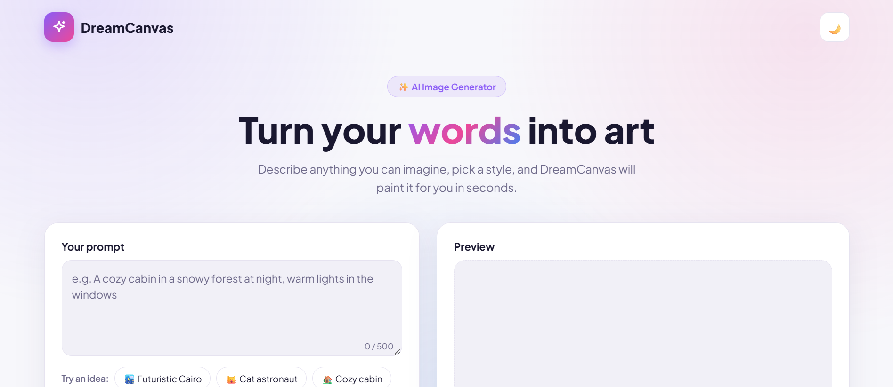
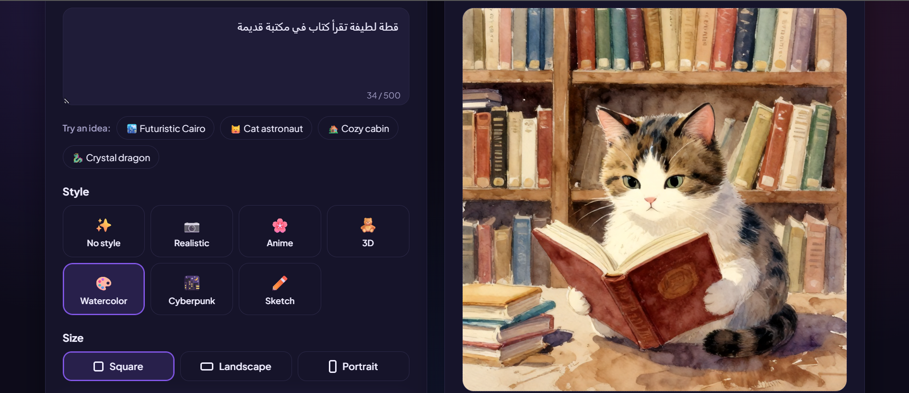
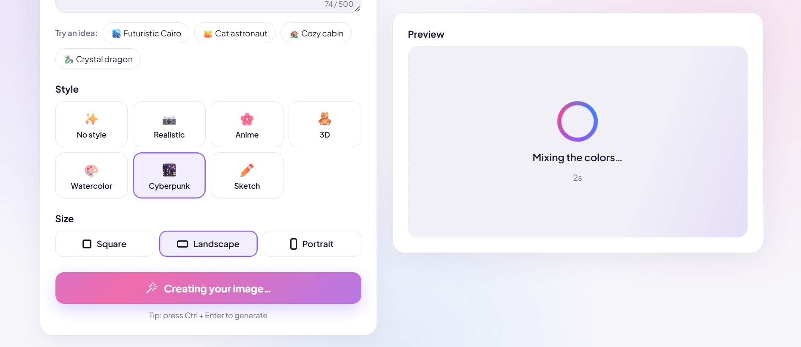
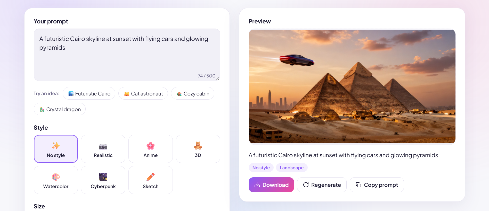
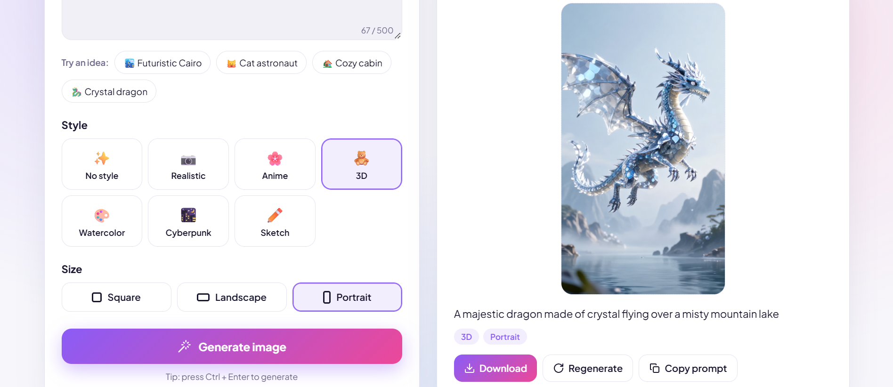
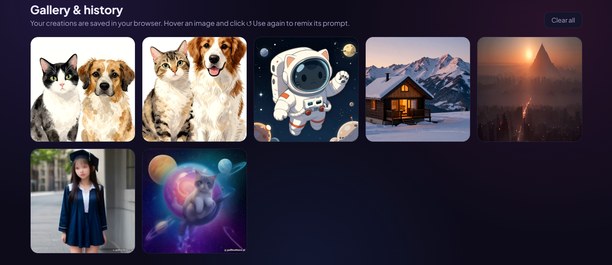
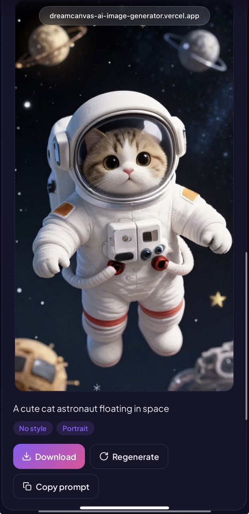

# 🎨 DreamCanvas: AI Image Generator

An **AI Image Generator** web app built with **Flask**. Type a text prompt, pick a style and a size, and DreamCanvas turns your words into an image in seconds. Every creation is saved in your browser's gallery, so you can open, download, or remix it later.

🔗 **Live demo:** [dreamcanvas-ai-image-generator.vercel.app](https://dreamcanvas-ai-image-generator.vercel.app/)

---

## 📸 Screenshots

| Homepage (light) | Homepage (dark) |
|---|---|
|  |  |

| Loading animation | Landscape result |
|---|---|
|  |  |

| Portrait result | Gallery & history |
|---|---|
|  |  |

| Mobile |
|---|
|  |

---

## ✨ Features

### Core features
| Feature | What it does |
|---|---|
| 🏠 **Attractive UI** | Clean hero section, gradient design, style cards, and one-click prompt ideas |
| ✍️ **Text prompt input** | Prompt box with a 500-character counter, idea chips, `Ctrl + Enter` shortcut, and Arabic (right-to-left) support |
| 🤖 **AI image generation** | Images generated through the Pollinations.ai API, called securely from the Flask backend |
| 🖼️ **Image preview** | The preview box takes the shape of the chosen size, with empty, loading, result, and error states |
| ⬇️ **Download** | Save any image with a clean file name based on its prompt |
| 📱 **Responsive design** | Works on desktop, tablet, and mobile, including touch screens |

### Bonus features
| Feature | What it does |
|---|---|
| 🕘 **Image history** | Every image keeps its prompt, style, size, and date, and **↺ Use again** puts them back into the form to remix |
| 🎭 **Multiple styles** | 7 styles: No style, Realistic, Anime, 3D, Watercolor, Cyberpunk, and Sketch |
| 🌙 **Dark mode** | Saved per browser, follows the system theme, and loads without a white flash |
| 🗂️ **Image gallery** | Your last 12 images are saved in the browser: open, delete, or clear them all |
| ⏳ **Loading animation** | Spinning gradient ring, shimmer effect, rotating messages, and a live timer |

### Extras
- 3 image sizes: **Square** (1024×1024), **Landscape** (1280×720), and **Portrait** (720×1280)
- **Regenerate** for a new variation and **Copy prompt** in one click
- Friendly error messages (too many requests, timeouts, service busy) and an automatic retry on server errors
- Keyboard accessible: focus rings, screen-reader labels, and reduced motion support

---

## 🛠️ Tech Stack

| Layer | Technology |
|---|---|
| Backend | Python 3.12, Flask 3 |
| AI images | Pollinations.ai API |
| Frontend | HTML (Jinja2), CSS, JavaScript |
| Storage | Browser `localStorage` (gallery and theme) |
| Hosting | Vercel |

---

## ⚙️ How It Works

```
Browser                         Flask backend                    Pollinations.ai
───────                         ─────────────                    ───────────────
prompt + style + size  ──POST /generate──►  validates input
                                            adds style words
                                            calls the API  ──────────►  creates the image
                                            (key stays on the server)
image shown + saved   ◄──── base64 image ◄────────────────────────────  returns the image
in the gallery
```

- The API key is read from an environment variable and sent in a request header, so it never reaches the browser
- Each request uses a new random seed, so the same prompt gives a new image every time
- The backend limits the total waiting time, so the page never hangs

---

## 📁 Project Structure

```
ai-image-generator/
├── app.py                 # Flask app: routes, validation and the image API call
├── requirements.txt
├── templates/
│   └── index.html         # The page layout
└── public/static/
    ├── css/style.css      # Design, dark mode and responsive styles
    └── js/script.js       # Generating, preview, gallery, history and dark mode
```

---

## 🚀 Run Locally

**1. Clone the repository**
```bash
git clone https://github.com/meroaymann/dreamcanvas-ai-image-generator.git
cd dreamcanvas-ai-image-generator
```

**2. Create a virtual environment and install the libraries**
```bash
python -m venv venv

# Windows
venv\Scripts\activate
# macOS / Linux
source venv/bin/activate

pip install -r requirements.txt
```

**3. (Optional) Add a free Pollinations API key**

Get a free key at [enter.pollinations.ai](https://enter.pollinations.ai), then create a `.env` file in the project folder:
```
POLLINATIONS_API_KEY=your_key_here
```
Without a key, the app still works using the public API (with a watermark and a slower rate limit).

**4. Start the app**
```bash
python app.py
```
Open **http://127.0.0.1:5000** and start creating. 🎨

---

## 👩‍💻 Author

**Amira Ayman**: Computer Science graduate (Data Science), German International University, Cairo

Built as **Task 4** of my Python Programming Internship at **Sqrock IT Solutions**.

- GitHub: [@meroaymann](https://github.com/meroaymann)
- Images generated with [Pollinations.ai](https://pollinations.ai)